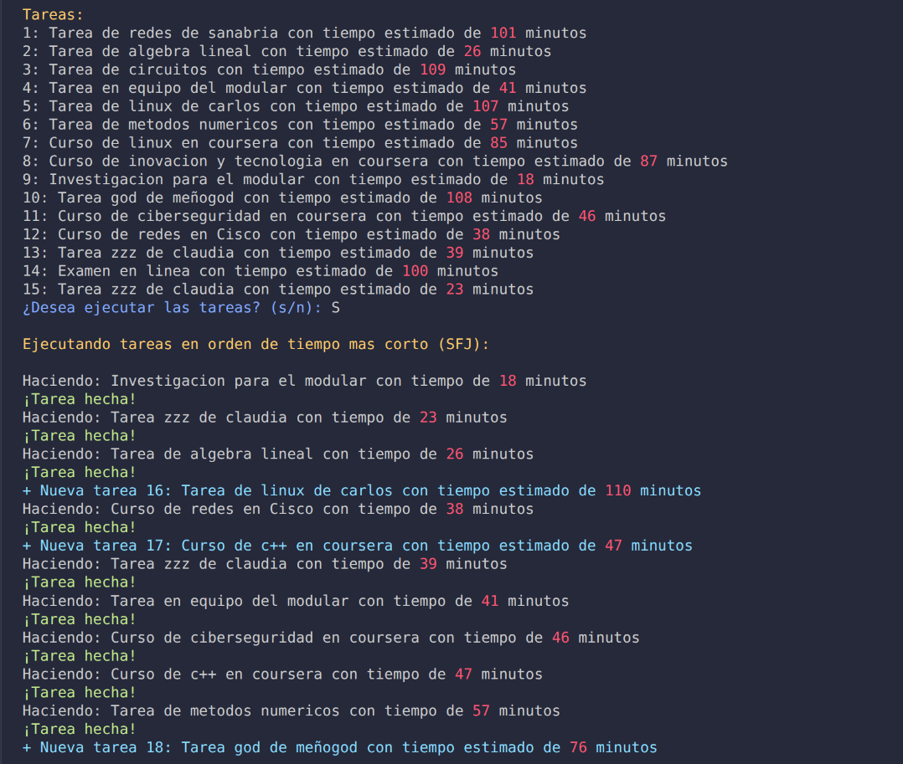

# ⏱️ Simulador SJF (Shortest Job First)
 
Simulación en consola, hecha en **Python**, del algoritmo de planificación **SJF (Shortest Job First / Trabajo más corto primero)**. El programa genera tareas escolares aleatorias con un tiempo estimado y las ejecuta siempre en orden de la más corta a la más larga, con un temporizador de cuenta regresiva.
 
Proyecto en equipo para la materia de Sistemas Operativos.
 
---
 
## 👥 Integrantes
 
- Leonel Figueroa Jauregui
- Jose Luis Vidrio Lizaola
- Miguel Angel Ochoa Jacinto
- Ricardo Paredes Sanchez
- Sergio Alexander Coronado Huerta
- Cesar de Jesus Becerra Vera
## 📖 ¿Qué es SJF?
 
SJF es un algoritmo de planificación de procesos que, entre todos los procesos listos, elige el que tiene el **menor tiempo de ejecución estimado**. Con esto se reduce el **tiempo promedio de espera** y se mejora la utilización de la CPU.
 
En esta simulación, los "procesos" son tareas escolares (tareas, exámenes, cursos) y el "CPU" es el estudiante que las va realizando una por una.
 
## ⚙️ Cómo funciona
 
1. Se generan **15 tareas aleatorias**, cada una con un tiempo estimado de **15 a 120 minutos**.
2. El programa muestra la lista de tareas y pregunta si quieres ejecutarlas.
3. En cada paso se selecciona la tarea con el **menor tiempo estimado** de las que están pendientes.
4. Se muestra un **temporizador de cuenta regresiva**: cada 15 minutos simulados equivalen a 1 segundo real (entre 1 y 8 segundos por tarea).
5. Al terminar cada tarea existe un **50 % de probabilidad** de que llegue una tarea nueva, que entra a la cola y compite con las demás. Estas se marcan como "llegó durante la ejecución".
6. Cuando ya no quedan tareas, se imprime un **resumen** con el orden real en que se completaron.
7. Al final puedes iniciar otra ronda con nuevas tareas.
El algoritmo es **no apropiativo**: una tarea que ya empezó no se interrumpe, aunque llegue otra más corta. La nueva se tomará en cuenta en la siguiente selección.
 
## 🎨 Colores en la consola
 
| Color | Significado |
|---|---|
| 🟡 Amarillo | Títulos y mensajes generales |
| 🔴 Rojo | Tiempos estimados |
| 🟢 Verde | Tarea terminada / ejecución completa |
| 🔵 Azul | Preguntas al usuario |
| 🩵 Cian | Tareas nuevas que llegan durante la ejecución |
 
## 🛠️ Tecnologías
 
- Python 3
- Librerías estándar: `random`, `time`, `os`, `platform` (no necesitas instalar nada extra)
## 🚀 Cómo ejecutarlo
 
1. Descarga o clona este repositorio.
2. Abre una terminal en la carpeta del proyecto.
3. Ejecuta:
```bash
python3 "SFJ(Shortest_job_first).py"
```
 
En Windows puedes usar `python` en lugar de `python3`. El programa limpia la pantalla automáticamente según el sistema operativo (`cls` en Windows, `clear` en Linux y macOS).
 
## 📸 Captura
 

 
## 📚 Conceptos que se practican
 
- Planificación de procesos (scheduling)
- Algoritmo SJF no apropiativo
- Llegada dinámica de procesos
- Programación orientada a objetos (clase `Tarea`)
- Manejo de consola con colores ANSI
